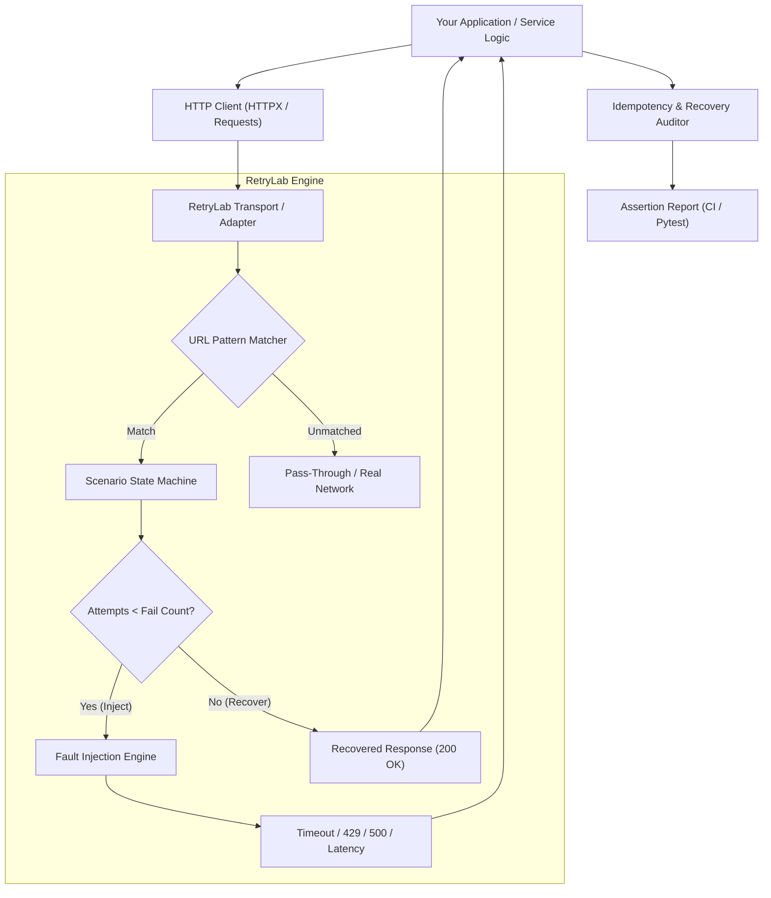

<div align="center">

# 🧪 RetryLab

### **Test failures. Verify recovery. Ship with confidence.**

*A local-first, zero-daemon polyglot API reliability testing and chaos engineering toolkit for Python, Go, and TypeScript.*

[](https://github.com/VimalN2005/retrylab/actions)
[](https://www.python.org/downloads/)
[](sdk/go)
[](sdk/ts)
[](https://github.com/VimalN2005/retrylab/releases)
[](https://github.com/VimalN2005/retrylab)
[](https://opensource.org/licenses/MIT)
[](https://github.com/astral-sh/ruff)

Simulate external API failures, test retry behaviour, and verify that your application recovers correctly — before those failures reach production.

[Quickstart](#-quickstart) • [Why RetryLab?](#-the-problem) • [Architecture](#-how-it-works) • [Demo](#-terminal-demo) • [Roadmap](#-roadmap-november-2026-sprint)

</div>

---

> [!NOTE]
> **Phase 3 Grand Release (`v0.3.0-alpha.1`):** Week 3 is complete! RetryLab now delivers a comprehensive developer experience with **Interactive Terminal TUI Dashboard** (`retrylab dashboard`), **Automated Scorecards** (`retrylab scorecard`), **Chaos Studio Web Playground** (`retrylab studio`), **GitHub Actions PR Commenter** (`retrylab pr-comment`), **DNS & SSL/TLS Network Chaos** (`retrylab network`), **Microsecond Polyglot Benchmarks** (`retrylab bench`), and **gRPC Chaos Simulation** (`retrylab grpc`) across **Python, Go, and TypeScript** with 215 automated tests!

---

## ⚡ The Problem

Modern backend and AI applications depend almost entirely on external third-party services:
- **AI APIs:** OpenAI, Anthropic, Cohere, and Hugging Face.
- **Payment Gateways:** Stripe, Adyen, Razorpay, and Plaid.
- **Messaging & Notifications:** Twilio, SendGrid, Resend, and Slack.
- **Cloud Infrastructure & SaaS:** AWS, GitHub, Supabase, and Redis Cloud.

In development and staging, these services almost always return `HTTP 200 OK`. But in production:
1. **OpenAI suddenly throws `HTTP 429 (Too Many Requests)`:** Does your application use exponential backoff with jitter, or does it trigger an unintended retry DDoS loop?
2. **Stripe drops connection halfway through a transaction:** Does your application retry with the exact same `Idempotency-Key`, or does it double-charge the customer?
3. **Twilio experiences a 15-second latency spike:** Does your worker thread pool starve and cascade into a complete service outage?
4. **Upstream payload mutation:** Does your retried request accidentally alter the payload body, causing downstream payment gateways to reject it with `HTTP 400`?

**Happy-path integration testing cannot reliably catch these failure modes.** Standard mocks (`unittest.mock`, `responses`) only return static responses and cannot verify dynamic recovery paths, idempotency guarantees, or backoff policies.

---

## 💡 What is RetryLab?

**RetryLab** is a developer-first testing engine that makes external dependency failure predictable, repeatable, and easily testable on your local machine and in CI pipelines.

Instead of waiting for an outage in production, developers configure deterministic failure scenarios (e.g., *"fail attempt 1 with a timeout, then recover on attempt 2"*) and verify whether their application survives and recovers cleanly.

---

## 🖥️ Terminal Demo

Here is RetryLab running an automated recovery and idempotency audit on a simulated Stripe checkout:

```text
==================================== RETRYLAB TEST RUN ====================================
[Scenario] Target: https://api.stripe.com/v1/charges | Fault: TIMEOUT | Failures: 1

--> Attempt #1: POST https://api.stripe.com/v1/charges
    [FAULT INJECTED] Simulated ReadTimeout (delay: 0.15s)
    [CLIENT LOG] Payment timed out! Triggering backoff retry...

--> Attempt #2: POST https://api.stripe.com/v1/charges
    [RECOVERED] Status: 200 OK | Response: {"status": "charge_confirmed"}
    [CLIENT LOG] Transaction confirmed on retry!

--------------------------------- RELIABILITY AUDIT ---------------------------------
[*] Total Outbound Requests: 2
[*] Injected Faults:         1 (Attempt #1)
[*] Recovery Status:         PASS (Clean recovery on Attempt #2)
[*] Idempotency Audit:       PASS (Same Idempotency-Key preserved: 'safe_order_tx_98765')
[*] Payload Integrity:       PASS (SHA-256 fingerprint matching across retries)
================================ 1 SCENARIO PASSED in 0.22s ================================
```

---

## 🎯 Key Features & Capabilities

| Capability | Status | Description |
| :--- | :---: | :--- |
| **HTTPX Sync Interception** | ✅ Ready | Custom `httpx.BaseTransport` for in-process sync client interception. |
| **HTTPX Async Interception** | ✅ Ready | `httpx.AsyncBaseTransport` for modern async/await FastAPI applications. |
| **Requests Adapter** | ✅ Ready | `requests.adapters.BaseAdapter` (`RetryLabAdapter`) for standard SDKs (e.g. `boto3`, `stripe`). |
| **Fault Matrix (429, 500, 503)** | ✅ Ready | Realistic status code generation with dynamic `Retry-After` headers. |
| **Timeout & Socket Resets** | ✅ Ready | Emulate `ReadTimeout`, `ConnectTimeout`, and sudden TCP disconnects. |
| **Dynamic Latency Engine** | ✅ Ready | Realistic network profiles: `FIXED`, `UNIFORM` jitter, `NORMAL` gaussian, and `SPIKE` models. |
| **Idempotency Auditor** | ✅ Ready | SHA-256 canonical JSON hashing to detect duplicate payments and payload mutations. |
| **Pytest Declarative Fixture** | ✅ Ready | `@pytest.mark.retrylab(...)` and `simulate_fault` fixtures for zero-boilerplate testing. |
| **YAML Scenario Runner** | ✅ Ready | Declarative YAML scenario parser (`load_scenario_from_yaml`) for cross-language teams. |
| **Multi-Step State Machine** | ✅ Ready | Progressive multi-step outages (`SequentialScenario`: Timeout ➔ 503 ➔ 200). |
| **Typer CLI Runner** | ✅ Ready | `retrylab validate`, `retrylab info`, and `retrylab drift` commands. |
| **Schema Drift Detector** | ✅ Ready | Detects breaking API contract changes (missing fields, unexpected types/nulls). |
| **Data Redaction & Security** | ✅ Ready | Automated scrubbing of Bearer tokens, OpenAI keys, and CVVs from test logs. |
| **HTTP Proxy Daemon** | ✅ Ready | `retrylab serve` local proxy server for cross-language testing (Go, Node.js, curl). |
| **Reliability Reports (HTML & MD)** | ✅ Ready | Beautiful self-contained dark HTML dashboards & GitHub PR Markdown summaries. |
| **Exponential Backoff Verifier** | ✅ Ready | Audits retry intervals, budget limits, and detects aggressive zero-delay spam. |
| **Traffic Recorder & Offline Replay** | ✅ Ready | Captures sanitized live requests and replays offline fixtures with fault injection. |
| **Circuit Breaker Auditor** | ✅ Ready | Verifies client fail-fast behavior and prevents cascading thundering herds. |
| **GitHub Actions CI Quality Gate** | ✅ Ready | Official GitHub Action & `retrylab gate` command for PR step summaries. |
| **Webhook Resilience & Chaos Engine** | ✅ Ready | HMAC signature forging, duplicate delivery, clock skew, and receiver audit CLI. |
| **Webhook Mock Receiver & Forwarding** | ✅ Ready | Local event inspector, forwarding tunnel (`retrylab webhook listen`), and offline fixture replay. |
| **SSE & LLM Streaming Disruption** | ✅ Ready | Mid-stream truncation, token dropouts, malformed JSON, stalls, and OpenAI/Anthropic presets. |
| **Socket & TCP Layer Chaos** | ✅ Ready | TCP RST connection resets, silent blackhole drops, slow drip trickle, and premature EOF. |
| **Go SDK (`http.RoundTripper`)** | ✅ Ready | In-process Go transport interceptor, SHA-256 idempotency auditor & backoff timing verifier. |
| **TypeScript / Node.js SDK (Fetch & Axios)** | ✅ Ready | In-process Fetch & Axios interceptor, SHA-256 idempotency auditor & backoff timing verifier. |
| **Polyglot Chaos Matrix** | ✅ Ready | Cross-language scenario schema generator for Python, Go structs, and TypeScript interfaces. |
| **Interactive TUI Dashboard** | ✅ Ready | Rich terminal reliability dashboard, letter grading (A+ to F), and live scenario monitor. |
| **Live Scenario Playback** | ✅ Ready | Step-by-step interactive terminal execution with real-time backoff countdowns (`retrylab play`). |
| **Chaos Studio Web Playground** | ✅ Ready | Local visual scenario builder, real-time in-flight waterfall, and polyglot SDK exporter (`retrylab studio`). |
| **SVG Visual Scorecards** | ✅ Ready | Standalone dark-mode vector graphics card with glows and recovery meters for PRs. |
| **GitHub Actions PR Commenter** | ✅ Ready | Automated sticky PR review commenter (`retrylab pr-comment`) with collapsible audit logs. |

---

## 🏗️ How It Works

RetryLab intercepts outbound HTTP traffic directly at the transport boundary before it reaches the network socket. No heavy Docker daemons, local proxies, or DNS hijacking required:



---

## 🚀 Quickstart

### 1. Installation

```bash
pip install retrylab
```

### 2. Testing OpenAI Rate-Limit Recovery (`HTTPX`)

```python
import httpx
from retrylab import FaultScenario, FaultType, RetryLabTransport

# Scenario: OpenAI returns 429 on attempt 1, then recovers on attempt 2
scenario = FaultScenario(
    target="https://api.openai.com/v1/*",
    fault=FaultType.RATE_LIMIT_429,
    retry_after_seconds=2,
    fail_count=1,
)

transport = RetryLabTransport(scenario=scenario)

with httpx.Client(transport=transport) as client:
    # Attempt 1 -> 429 Rate Limit (Header: Retry-After: 2)
    resp1 = client.post("https://api.openai.com/v1/chat/completions", json={"model": "gpt-4o"})
    assert resp1.status_code == 429
    
    # Attempt 2 -> 200 OK (Application recovers after respecting backoff)
    resp2 = client.post("https://api.openai.com/v1/chat/completions", json={"model": "gpt-4o"})
    assert resp2.status_code == 200
```

### 3. Auditing Stripe Payment Idempotency (`Requests` or `HTTPX`)

```python
from retrylab import FaultScenario, FaultType, IdempotencyAuditor, RetryLabTransport

scenario = FaultScenario(
    target="https://api.stripe.com/v1/charges",
    fault=FaultType.TIMEOUT,
    fail_count=1,
)
auditor = IdempotencyAuditor(idempotency_header="Idempotency-Key")

# Run your payment code with RetryLab transport attached...
# If your application changes the idempotency key or alters the payload body on retry:
auditor.assert_idempotent(scenario)
# Raises IdempotencyViolationError if any double-charge or mutation risk is found!
```

---

## 📄 Declarative YAML Scenario Preview (Planned)

Define scenarios once and run them anywhere:

```yaml
version: 1
name: payment_resilience_test
match:
  method: POST
  url: "https://api.stripe.com/v1/charges"
steps:
  - kind: fault
    type: timeout
    delay: 0.2s
  - kind: fault
    type: http_status
    code: 503
    retry_after: 2
  - kind: recover
    code: 200
    body:
      status: "succeeded"
      charge_id: "ch_987654321"
assertions:
  max_retries: 3
  enforce_idempotency: true
  idempotency_header: "Idempotency-Key"
```

### 5. Webhook Ingestion & Resilience Audit

Test your incoming webhook endpoint against duplicate deliveries, forged HMAC signatures, and expired timestamps:

```bash
# Run security & idempotency audit on your local webhook endpoint
retrylab webhook audit http://localhost:8000/api/v1/webhooks/stripe --secret "whsec_test" --scheme stripe_v1

# Dispatch duplicate synthetic events to test idempotent at-least-once ingestion
retrylab webhook dispatch http://localhost:8000/api/v1/webhooks/stripe --secret "whsec_test" --chaos duplicate --duplicates 3

# Start a local mock webhook listener with fault injection (fail first 2 attempts with HTTP 500)
retrylab webhook listen --port 8085 --secret "whsec_test" --fail-first 2 --fail-status 500 --forward-to http://localhost:8000/api/webhook

# Replay recorded webhook event fixtures against an endpoint
retrylab webhook replay fixtures/stripe_webhooks.json --target http://localhost:8000/api/webhook
```

### 6. AI Agent & LLM Stream Disruption

Simulate mid-stream network dropouts and corrupted token deltas against OpenAI or Anthropic streaming endpoints:

```bash
# Simulate premature stream truncation (disconnect after 4 tokens)
retrylab stream simulate --preset openai --chaos truncate --truncate-after 4

# Simulate mid-stream API 503 generation crash
retrylab stream simulate --preset anthropic --chaos inject_error
```

### 7. Socket & TCP Layer Chaos Simulation

Verify that your application handles raw connection resets, blackhole timeouts, and slow drip bandwidth throttling:

```bash
# Simulate TCP connection reset (RST packet)
retrylab socket simulate --fault connection_reset

# Simulate silent packet blackhole drop leading to read timeout
retrylab socket simulate --fault silent_drop --timeout 1.0

# Simulate slow drip bandwidth throttling (trickle 4 bytes per chunk)
retrylab socket simulate --fault slow_drip --drip-rate 4
```

### 8. Cross-Language Go SDK (`http.RoundTripper`)

In Go microservices and backends, inject failure scenarios directly into standard Go `http.Client`:

```go
package main

import (
    "net/http"
    "github.com/VimalN2005/retrylab/sdk/go/retrylab"
)

func main() {
    // Intercept outbound calls to api.stripe.com: fail first 2 attempts with HTTP 429
    transport := retrylab.NewTransport(retrylab.Scenario{
        URLPattern:    "api.stripe.com",
        Fault:         retrylab.FaultHTTPStatus,
        FailCount:     2,
        StatusCode:    http.StatusTooManyRequests,
        RecoverStatus: http.StatusOK,
    })

    client := &http.Client{Transport: transport}
    // Your Go application logic here...
}
```

### 9. Cross-Language TypeScript & Node.js SDK (`Fetch` & `Axios`)

In Node.js, Bun, Deno, or frontend Next.js applications, intercept Fetch and Axios calls in-process:

```typescript
import { createRetryLabFetch, IdempotencyAuditor } from '@retrylab/retrylab';

// Intercept outbound calls to OpenAI: fail first 2 attempts with HTTP 429
const customFetch = createRetryLabFetch({
  urlPattern: 'api.openai.com',
  fault: 'http_status',
  failCount: 2,
  statusCode: 429,
  recoverStatus: 200,
});

// Use customFetch in your application or pass to @openai/openai SDK
const res = await customFetch('https://api.openai.com/v1/chat/completions', {
  method: 'POST',
  headers: { 'Content-Type': 'application/json', 'Idempotency-Key': 'key_ai_123' },
  body: JSON.stringify({ model: 'gpt-4o', messages: [{ role: 'user', content: 'Hi' }] }),
});

// Audit idempotency and payload preservation across retries
const auditor = new IdempotencyAuditor('Idempotency-Key');
const report = auditor.audit(customFetch.history);
console.log(report.passed); // true
```

### 10. Interactive Terminal TUI Dashboard & Scorecard

Audit your application's third-party resilience interactively in the terminal:

```bash
# Launch full multi-service demo dashboard
retrylab dashboard --demo

# Generate automated letter grade scorecard (A+, A, B, C, F) for CI or terminal
retrylab scorecard --demo

# Output machine-readable JSON or GitHub Markdown report
retrylab scorecard --demo --format json
retrylab scorecard --demo --format markdown

# Step-through interactive scenario playback with live terminal countdowns
retrylab play scenarios/stripe_timeout.yaml --step
```

### 11. Local Chaos Studio Web Playground (`retrylab studio`)

Launch a zero-dependency, local-first visual chaos engineering studio directly in your browser:

```bash
# Launch Chaos Studio on http://127.0.0.1:8400
retrylab studio

# Specify custom port or disable auto-opening browser
retrylab studio --port 8080 --no-open
```

Features included in Chaos Studio:
- **Visual Scenario Builder:** Configure URL patterns, methods, status codes, socket resets, delays, and fail counts.
- **Curated Industry Presets:** One-click simulation templates for Stripe payment timeouts, OpenAI 429 rate limits, and Twilio 503 carrier overloads.
- **In-Flight Request Waterfall:** Real-time visual timeline showing each retry attempt, duration, status codes, and SHA-256 idempotency verification.
- **Polyglot SDK Exporter:** Instant real-time code generation for Python (HTTPX), Go SDK (`http.RoundTripper`), TypeScript SDK (Fetch/Axios), and YAML.

### 12. Automated GitHub Actions PR Commenter & SVG Visual Scorecard

Post automated, beautiful reliability audit reviews directly to your Pull Requests:

```bash
# Generate SVG visual scorecard and formatted GitHub PR markdown comment
retrylab pr-comment --demo --svg-out .github/assets/scorecard.svg --comment-out pr_comment.md --commit-sha $GITHUB_SHA

# Enforce resilience quality threshold in CI (exits code 1 if score < 80.0)
retrylab pr-comment --scenario scenarios/stripe_timeout.yaml --fail-under 80.0
```

Included in GitHub PR comments:
- **Embedded SVG Resilience Card:** High-resolution dark-mode badge with overall letter grade (`A+` to `F`), glowing borders, and progress meters.
- **Service-by-Service Breakdown:** Request counts, injected faults, clean recovery verification, and SHA-256 idempotency protection status.
- **Actionable Recommendations:** Specific code and configuration guidance to prevent upstream stampedes or double charges.

### 13. Network-Layer Chaos Simulation (DNS & SSL/TLS)

Simulate hard-to-reproduce lower-level network anomalies like DNS resolution dropouts, DNS timeouts, and SSL/TLS certificate verification failures:

```bash
# Simulate DNS failure and test client recovery via CLI
retrylab network simulate --fault dns_failure --url https://api.stripe.com/v1/charges

# Simulate SSL certificate verification failure
retrylab network simulate --fault ssl_cert_verification_failed

# Simulate TLS negotiation / handshake timeout
retrylab network simulate --fault tls_handshake_timeout
```

Or inject directly into Python client transports:

```python
import httpx
from retrylab import FaultScenario, FaultType, RetryLabTransport

scenario = FaultScenario(
    target="https://api.stripe.com/*",
    fault=FaultType.DNS_FAILURE,
    fail_count=1,
)

transport = RetryLabTransport(scenario=scenario)
client = httpx.Client(transport=transport)

# Attempt 1: Raises httpx.ConnectError wrapping socket.gaierror
# Attempt 2: Recovers smoothly with HTTP 200 OK
```

Supported network fault models:
- `FaultType.DNS_FAILURE`: Simulates `getaddrinfo` resolution failure (`[Errno 11001] getaddrinfo failed`).
- `FaultType.DNS_TIMEOUT`: Simulates DNS resolver timeout (`socket.timeout: DNS resolution query timed out`).
- `FaultType.TLS_HANDSHAKE_TIMEOUT`: Simulates TLS negotiation timeout (`ssl.SSLError: TLS handshake negotiation timed out`).
- `FaultType.SSL_CERT_VERIFICATION_FAILED`: Simulates invalid or untrusted certificate chain (`ssl.SSLCertVerificationError: [SSL: CERTIFICATE_VERIFY_FAILED]`).
- `FaultType.SSL_HOSTNAME_MISMATCH`: Simulates hostname mismatch error (`ssl.CertificateError: hostname 'api.stripe.com' doesn't match 'wildcard.example.internal'`).

### 14. Polyglot Latency & Throughput Benchmark (`retrylab bench`)

Measure microsecond and nanosecond interception overhead across Python, Go, and TypeScript SDKs:

```bash
# Run unified benchmark across all languages (1,000 iterations)
retrylab bench --lang all --iterations 1000

# Benchmark individual language SDK
retrylab bench --lang go
retrylab bench --lang ts
retrylab bench --lang python

# Export machine-readable JSON metrics
retrylab bench --lang all --format json --json-out benchmarks/results.json
```

### 15. gRPC & Protobuf Chaos Simulation (`retrylab grpc`)

Simulate canonical gRPC status code failures (`UNAVAILABLE`, `DEADLINE_EXCEEDED`, `RESOURCE_EXHAUSTED`, `INTERNAL`) and test client stubs and retry policies:

```bash
# Simulate gRPC UNAVAILABLE error and verify application recovery
retrylab grpc simulate --method /payment.PaymentService/ProcessPayment --status UNAVAILABLE

# Simulate DEADLINE_EXCEEDED with injected latency
retrylab grpc simulate --method /vector.VectorDB/Search --status DEADLINE_EXCEEDED --delay-ms 50

# Simulate RESOURCE_EXHAUSTED (rate-limiting / quota drop)
retrylab grpc simulate --status RESOURCE_EXHAUSTED
```

Or inject directly into Python `grpc.Channel` via `RetryLabUnaryClientInterceptor`:

```python
import grpc
from retrylab.grpc import GRPCFaultConfig, GRPCStatusCode, RetryLabUnaryClientInterceptor

config = GRPCFaultConfig(
    method_pattern="/payments.PaymentService/*",
    status_code=GRPCStatusCode.UNAVAILABLE,
    details="Simulated downstream cluster outage",
    fail_count=1,
)

interceptor = RetryLabUnaryClientInterceptor(config=config)
channel = grpc.intercept_channel(grpc.insecure_channel("localhost:50051"), interceptor)

# Attempt 1: Raises grpc.RpcError wrapping StatusCode.UNAVAILABLE
# Attempt 2: Recovers smoothly with gRPC Status OK
```

Supported canonical gRPC status codes:
`OK` (0), `CANCELLED` (1), `UNKNOWN` (2), `INVALID_ARGUMENT` (3), `DEADLINE_EXCEEDED` (4), `NOT_FOUND` (5), `ALREADY_EXISTS` (6), `PERMISSION_DENIED` (7), `RESOURCE_EXHAUSTED` (8), `FAILED_PRECONDITION` (9), `ABORTED` (10), `OUT_OF_RANGE` (11), `UNIMPLEMENTED` (12), `INTERNAL` (13), `UNAVAILABLE` (14), `DATA_LOSS` (15), `UNAUTHENTICATED` (16).

### 16. Installation Health & Diagnostic Doctor (`retrylab doctor`)

Audit runtime compatibility, PEP 561 type definitions, embedded web assets, and polyglot SDK compilers with automated diagnostic verification:

```bash
# Pretty-printed Rich diagnostic report table
retrylab doctor

# Machine-parseable JSON for CI pipeline health gates
retrylab doctor --format json
```

Key diagnostic checks:
- **Python Runtime:** Confirms Python $\ge 3.10$ and 64-bit AMD64/ARM64 architecture.
- **Subpackage Integrity:** Verifies zero-warning imports across all 12 core submodules.
- **Packaging & PEP 561:** Validates `retrylab/py.typed` marker for IDE auto-complete/type-checking, `MANIFEST.in`, and embedded Chaos Studio assets.
- **Polyglot Toolchains:** Detects Go compiler (`go version`) and Node.js runtime (`node -v`) for multi-language SDK development.
- **Terminal Capabilities:** Confirms UTF-8 console output and box rendering support.

### 17. End-to-End Stress & Soak Testing (`retrylab soak`)

Simulate high-concurrency sustained traffic, prolonged rate-limiting (429), upstream outages (503), and quantify your application's **Retry Storm Amplification Factor** under load:

```bash
# Run a 5-second soak test with 10 concurrent workers
retrylab soak --duration 5.0 --concurrency 10

# Test resilience under prolonged 429 rate-limiting with strict retry storm threshold
retrylab soak --mode 429 --rate 0.50 --max-storm-factor 2.5

# Export full machine-parseable soak metrics for CI load gates
retrylab soak --format json --json-out benchmarks/soak_results.json
```

#### The Retry Storm Amplification Factor ($A$)
When downstream services degrade, poorly-tuned retry loops cause **thundering herds** that multiply traffic and permanently crash backends:

$$A = \frac{\text{Total Network Attempts}}{\text{Logical User Requests}}$$

- $A < 1.30\times$: **NORMAL** (Healthy exponential backoff with full jitter)
- $1.30\times - 2.00\times$: **ELEVATED** (Moderate retry pressure)
- $2.00\times - 3.50\times$: **DANGEROUS** (Aggressive retries straining downstream capacity)
- $A > 3.50\times$: **CRITICAL** (Catastrophic retry storm / thundering herd)

Programmatic soak testing in Python:

```python
from retrylab.soak import SoakConfig, SoakFaultMode, run_soak_test

config = SoakConfig(
    duration_seconds=5.0,
    concurrency=20,
    failure_rate=0.40,
    fault_mode=SoakFaultMode.MIXED_STORM,
    burst_enabled=True,
)

result = run_soak_test(config)
print(f"Recovery Rate: {result.recovery_rate:.1f}%")
print(f"Storm Factor: {result.storm_amplification_factor:.2f}x ({result.storm_severity})")
print(f"P99 Latency: {result.p99_latency_ms:.1f}ms")
```

### 18. Interactive Guided Resilience Tour (`retrylab tour`)

Launch an interactive, hands-on terminal walkthrough that demonstrates how RetryLab protects applications across 5 essential reliability patterns:

```bash
# Interactive guided tour with step-by-step pauses
retrylab tour

# Non-interactive automated execution (ideal for CI and recordings)
retrylab tour --auto

# Jump directly to a specific tour stop (e.g. Stop 2: Cryptographic Idempotency)
retrylab tour --step 2

# Export full tour catalog in structured JSON
retrylab tour --format json
```

#### Tour Itinerary (5 Interactive Stops)
1. **Stop 1: HTTP 429 Rate Limiting & Clean Recovery:** Multi-attempt recovery sequences replacing static mocks.
2. **Stop 2: Cryptographic Idempotency Shield:** SHA-256 request body fingerprinting preventing duplicate billing.
3. **Stop 3: AI Token & SSE Stream Disruption:** Mid-stream socket cutoffs with seamless `Last-Event-ID` resumption.
4. **Stop 4: gRPC Microservices Chaos:** In-process canonical gRPC error injection with actionable retry recommendations.
5. **Stop 5: Retry Storm Amplification & Soak:** Quantifying traffic multiplication factor ($A < 1.30\times$) to prevent thundering herds.

### 19. Docker Chaos Sidecar (`retrylab sidecar`) & Zero-Code Polyglot Deployment

Attach RetryLab fault injection, rate limiting, and recovery verification to **any container, Kubernetes pod, or microservice stack** (Python, Go, Node, Java, Rust, Ruby, C#) without changing application code:

```bash
# Launch containerized chaos sidecar proxy on port 8080
retrylab sidecar --port 8080 --scenario examples/sidecar_demo.yaml

# Reverse-proxy mode: Intercept and forward to upstream API target
retrylab sidecar --port 8080 --target https://api.stripe.com --scenario examples/sidecar_demo.yaml

# Query sidecar health probe and metrics
curl http://localhost:8080/_retrylab/health
curl http://localhost:8080/_retrylab/metrics
```

#### Zero-Config Docker Compose Deployment

```yaml
services:
  retrylab-sidecar:
    image: retrylab/sidecar:latest
    ports:
      - "8080:8080"
    volumes:
      - ./scenarios:/scenarios:ro
    command: ["--host", "0.0.0.0", "--port", "8080", "--scenario", "/scenarios/sidecar_demo.yaml"]
    healthcheck:
      test: ["CMD-SHELL", "python -c \"import urllib.request; urllib.request.urlopen('http://127.0.0.1:8080/_retrylab/health')\""]

  # Any polyglot client service routes through the sidecar
  my-app:
    image: my-service:latest
    environment:
      - HTTP_PROXY=http://retrylab-sidecar:8080
      - STRIPE_API_BASE=http://retrylab-sidecar:8080
```

---

## 📐 Design Principles

- 🏠 **Local-First:** Core tests run 100% in-process on your developer machine without spinning up external servers or Docker containers.
- 🎲 **Deterministic:** The exact same scenario config generates the exact same sequence of failures every single time.
- 🛡️ **Safe by Default:** Never sends unintended external network calls during testing.
- 🔒 **Privacy-Conscious:** Sensitive headers (Bearer tokens, Authorization, CVV) are automatically redacted in audit reports.
- ⚡ **CI-Ready:** Seamlessly runs inside GitHub Actions, GitLab CI, or CircleCI with zero configuration overhead.

---

## 🗺️ Roadmap (November 2026 Sprint)

| Phase | Timeline | Focus | Status |
| :--- | :--- | :--- | :---: |
| **Phase 1: Foundation & Core Matrix** | Nov 1 – Nov 7 | Sync/Async HTTPX Transports, Requests Adapter, Dynamic Latency, Cryptographic Idempotency, YAML Scenarios, Pytest Plugin, Security Redactor, Schema Drift, HTTP Proxy, Reports, Fixture Replay, CI Gate | **✅ COMPLETED (100%)** |
| **Phase 2: Advanced Chaos & Webhooks** | Nov 8 – Nov 14 | Webhooks, SSE stream disruption, TCP socket cutoffs, Go SDK, TypeScript SDK, Polyglot Matrix (`v0.2.0-alpha.1`) | **✅ COMPLETED (100%)** |
| **Phase 3: DX & Multi-Language SDKs** | Nov 15 – Nov 21 | Interactive CLI Scorecard & TUI, Chaos Studio Web Playground, PR Commenter, Fault Matrix expansions (DNS, TLS), SDK benchmarks, gRPC alpha (`v0.3.0-alpha.1`) | **✅ COMPLETED (100%)** |
| **Phase 4: Launch & Ecosystem** | Nov 22 – Nov 30 | Production packaging, PEP 561 compliance, soak testing, Docker sidecar, production v1.0 | ⚡ **IN PROGRESS** |
| &nbsp;&nbsp;↳ **Day 22** | Nov 22 | Packaging Hardening, PEP 561 `py.typed`, Source Manifest & `retrylab doctor` | **✅ COMPLETED (100%)** |
| &nbsp;&nbsp;↳ **Day 23** | Nov 23 | End-to-End Stress & Soak Testing Suite under sustained 429/503 storm | **✅ COMPLETED (100%)** |
| &nbsp;&nbsp;↳ **Day 24** | Nov 24 | Interactive Guided Resilience Tour (`retrylab tour`) & onboarding suite | **✅ COMPLETED (100%)** |
| &nbsp;&nbsp;↳ **Day 25** | Nov 25 | Docker Containerized Chaos Sidecar & Zero-Config Deployment | **✅ COMPLETED (100%)** |
| &nbsp;&nbsp;↳ **Day 26** | Nov 26 | Distributed Trace Header Propagation (W3C TraceContext & OpenTelemetry) | ⚡ **Next Up** |

---

## 🏎️ Performance Benchmarks

RetryLab is engineered for extreme efficiency with **zero-daemon in-process transport interception**:

### Polyglot SDK Performance Matrix (1,000 Iterations)

| Language / SDK | Component / Scenario | Mean Latency | P50 (Median) | P99 Latency | Throughput | Added Overhead |
| :--- | :--- | :---: | :---: | :---: | :---: | :---: |
| **Go SDK** | Baseline `http.RoundTripper` | `0.59 µs` | `< 0.1 µs` | `9.56 µs` | **1,694,000 req/s** | Baseline |
| **Go SDK** | RetryLab Interceptor | `0.54 µs` | `< 0.1 µs` | `8.71 µs` | **1,860,000 req/s** | **+0.00 µs** |
| **TypeScript SDK** | Baseline Fetch | `9.23 µs` | `5.75 µs` | `60.48 µs` | **108,300 req/s** | Baseline |
| **TypeScript SDK** | RetryLab Interceptor | `3.50 µs` | `3.00 µs` | `9.91 µs` | **285,800 req/s** | **< 0.005 ms** |
| **Python Core** | Baseline HTTPX Transport | `31.90 µs` | `29.40 µs` | `76.18 µs` | **31,343 req/s** | Baseline |
| **Python Core** | RetryLab Interceptor | `74.24 µs` | `63.60 µs` | `210.61 µs` | **13,470 req/s** | **+0.042 ms** |

### RetryLab vs External Proxy Daemons (Toxiproxy / WireMock)

| Dimension | **RetryLab (In-Process)** | **Toxiproxy (Shopify)** | **WireMock (Java/Docker)** |
| :--- | :---: | :---: | :---: |
| **Architecture** | **Zero-Daemon In-Process** | External TCP Proxy Daemon | Standalone JVM HTTP Server |
| **Go Interception Overhead** | **~ 540 nanoseconds** | ~ 1.8 ms – 3.5 ms (3,500x slower) | ~ 8.0 ms – 15.0 ms |
| **TS Interception Overhead** | **~ 3.5 microseconds** | ~ 2.0 ms – 4.0 ms (1,000x slower) | ~ 8.0 ms – 15.0 ms |
| **Python Interception Overhead** | **~ 42.3 microseconds** | ~ 2.5 ms – 5.0 ms (100x slower) | ~ 8.0 ms – 20.0 ms |
| **Daemon Memory Footprint** | **0 MB (in-process)** | ~ 30 MB – 60 MB | ~ 150 MB – 350 MB |
| **TCP Sockets Consumed** | **0 open sockets** | 1 socket per simulated service | 1 port per server instance |
| **CI Parallel Safety** | **100% collision-free** | Port collision risk | Port collision risk |

*See [benchmarks/RESULTS.md](benchmarks/RESULTS.md) for full benchmark methodology and reproducibility instructions.*

---

## 🤝 Contributing

Contributions from the developer community are warmly welcomed! Whether it is adding new fault models, improving documentation, or adding client adapters:

1. Fork the repository.
2. Create your feature branch (`git checkout -b feat/amazing-fault-model`).
3. Ensure all tests pass (`pytest -v`).
4. Commit your changes (`git commit -m "feat: add new fault model"`).
5. Push to the branch and open a Pull Request.

---

## 🔐 Security & Responsible Testing

RetryLab is intended exclusively for local and CI resilience testing in staging/test environments.
- **Do not** hardcode production API credentials, real card tokens, or customer PII in scenario files.
- To report a security concern, please contact [vimaln2005@users.noreply.github.com](mailto:vimaln2005@users.noreply.github.com) privately.

---

## 📜 License

Distributed under the **MIT License**. See [LICENSE](LICENSE) for more details.

<div align="center">

**RetryLab** — *Don't just test success. Test recovery.*

</div>
